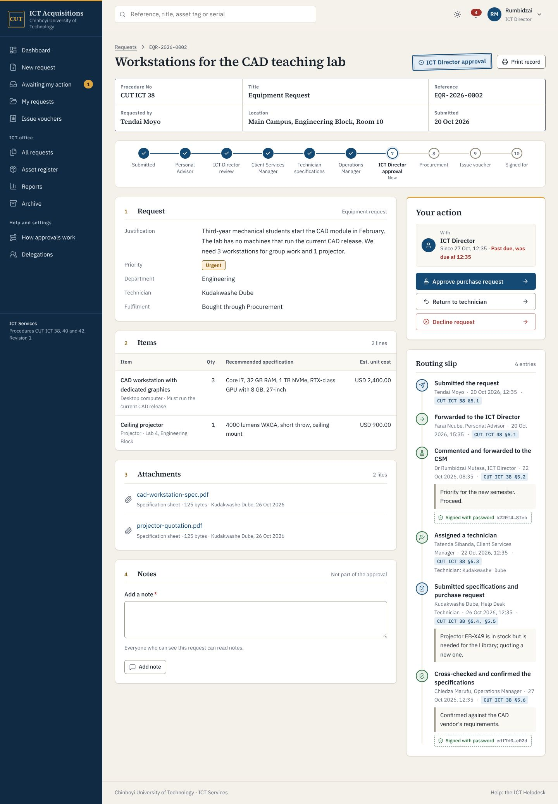

# CUT ICT Acquisition System

Online requests, approvals and hand-over of ICT equipment for Chinhoyi University of Technology. The system follows three ICT procedures, all at Revision 1 and effective 22 January 2026:

| Procedure | Title | In the system |
| --- | --- | --- |
| CUT ICT 38 | Equipment Request | Equipment request: Personal Advisor, ICT Director, Client Services Manager, technician specifications, Operations Manager, ICT Director approval, Procurement |
| CUT ICT 40 | ICT Asset Allocation | Allocation from stock, and the issue voucher every route ends with |
| CUT ICT 42 | Asset Acquisition (replacement) | Replacement request: CSM recommendation, ICT Director approval, specification sheet, Procurement, logging of the delivered equipment |

Staff submit once. The request moves from desk to desk, each officer signs with their password, and anyone involved can see whose desk it is on and for how long.



## Features

- One request centre for the three procedures, with conversion from allocation to equipment request when ICT has no stock
- Password-signed decisions with a first-person statement, recorded on a hash-chained routing slip
- Return for changes at every stage, decline by the ICT Director only, cancellation rules
- Separation of duties, independent checks, and dated delegations for officers on leave
- Asset register with a full movement history; issue vouchers that the user signs for serials, specification and condition
- Stage targets in working days (weekends and public holidays skipped), daily reminders, Procurement follow-up dates
- Reports for the SOP KPIs and Excel exports of the request and asset registers
- Retention and archiving per procedure; nothing is ever deleted
- Sign-in by email or staff number, optional sign-in with the university directory (LDAP or Active Directory)
- Read-only JSON API for other CUT systems; CSV import of staff and of the existing asset register
- Accessible, responsive pages in light and dark themes, with custom error pages

## Quick start on a laptop

Needs Python 3.11 or later.

```bash
python3 -m venv .venv && . .venv/bin/activate && pip install -r requirements-dev.txt
```

```bash
echo "DJANGO_DEBUG=true" > .env && python manage.py migrate && python manage.py seed_demo
```

```bash
python manage.py runserver
```

Open http://127.0.0.1:8000 and sign in with one of the demo accounts the seed prints, for example `rumbidzai.mutasa@demo.cut.local` (ICT Director) or `tendai.moyo@demo.cut.local` (requester). They all use the password `Demo-Pass-2026`. The names are fictional.

Run the tests:

```bash
python manage.py test
```

## Documentation

| Document | For |
| --- | --- |
| [01 Plan, loophole review and revised plan](docs/01-design-review.md) | How the design was reached |
| [02 System overview](docs/02-overview.md) | Everyone |
| [03 Workflows and SOP traceability](docs/03-workflows.md) | QMS, auditors, ICT management |
| [04 Roles and permissions](docs/04-roles-and-permissions.md) | ICT management, administrators |
| [05 Architecture](docs/05-architecture.md) | Developers |
| [06 Deployment and operations](docs/06-deployment.md) | ICT systems team |
| [07 Integration with CUT systems](docs/07-integration.md) | ICT systems team |
| [08 Security](docs/08-security.md) | ICT security, auditors |
| [09 User guide](docs/09-user-guide.md) | Staff and officers |
| [10 Administration](docs/10-administration.md) | System administrators |
| [11 Testing](docs/11-testing.md) | Developers, auditors |
| [12 Observations on the SOPs](docs/12-sop-observations.md) | QMS team |

## Technology

Django 5.2 LTS, PostgreSQL, server-rendered templates with hand-written CSS and a small amount of plain JavaScript, Gunicorn and Nginx. Fonts and icons are served by the application, so pages work on the campus network without reaching the internet. See [docs/05-architecture.md](docs/05-architecture.md).

## Before go-live

1. Replace the `CUT` monogram with the official crest if the university approves its use (`templates/base.html`, `templates/base_auth.html`, `static/img/favicon.svg`).
2. Confirm the stage targets with the ICT Director ([docs/03-workflows.md](docs/03-workflows.md)).
3. Test directory sign-in and email against CUT's servers on a staging copy ([docs/11-testing.md](docs/11-testing.md) lists what was not tested here).
4. Load staff, roles, campuses, departments, holidays and the current asset register ([docs/06-deployment.md](docs/06-deployment.md)).

## Licences

Fonts: IBM Plex Sans, IBM Plex Mono and Source Serif 4 under the SIL Open Font Licence 1.1 (`static/fonts/`). Icons: Lucide under the ISC licence (`static/icons/`). The licence for this application's own code is for the university to decide.
