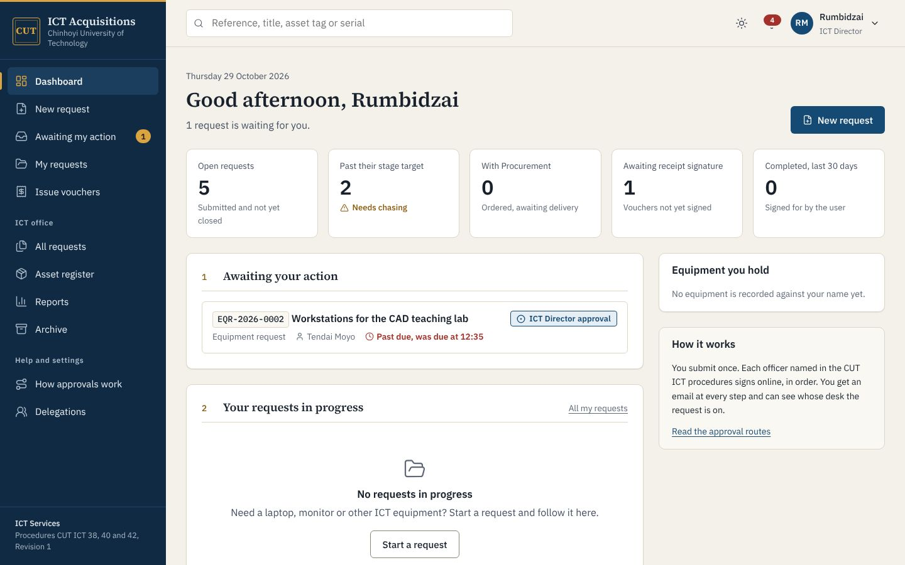

# System overview

## The problem

A CUT staff member who needs a laptop today carries a paper request from desk to desk. CUT ICT 38 alone routes a request through five officers: the Personal Advisor, the ICT Director, the Client Services Manager, a Help Desk Technician and the Operations Manager, with the Director signing twice. Each signature can mean another walk across campus or another day of waiting, and nobody can say where the paper is.

The ICT Acquisition System moves the request instead of the person. The requester fills in one form. The system sends it to the next desk, emails that officer, records each decision with the officer's password as a signature, and shows everyone the current desk and the time it has spent there.

## Scope

| Request type | Procedure | Use it when |
| --- | --- | --- |
| Allocation from ICT stock | CUT ICT 40 | You need an item ICT may already hold, such as a monitor, headset or loan laptop |
| Equipment request | CUT ICT 38 | You have a new requirement that will probably need buying |
| Replacement request | CUT ICT 42 | Your current machine is faulty, damaged, lost or too slow for your work |

All three end the same way. A Help Desk Technician raises an issue voucher (CUT ICT 40 §5.2) and the user signs for the serial numbers, specification and condition (CUT ICT 40 §5.3).

## A request from start to finish

1. The requester describes the need, lists the items and gives the location. The form starts with the location on their profile.
2. The system issues a reference (for example `EQR-2026-0042`) and sends the request to the first desk for its type.
3. Each officer opens the request from their queue or from the email link. They see the items, attachments, the route so far and every earlier comment.
4. Officers who sign (the ICT Director, the Operations Manager, the CSM on replacements, and the requester at receipt) enter their password. The routing slip shows the signature with a short form of its audit hash.
5. The technician records the Procurement requisition number, logs follow-ups, and enters each delivered item into the asset register.
6. The technician raises the issue voucher. The requester checks three boxes (serials, specification, condition), enters their password, and the assets move into their name.

## Screens

| Screen | Shown to | Purpose |
| --- | --- | --- |
| Dashboard | Everyone | Requests waiting for you, your requests in progress, equipment you hold; office figures for ICT staff |
| Awaiting my action | Everyone | The queue, oldest due date first |
| Request page | Requester and ICT staff | The SOP header grid, progress tracker, details, attachments, vouchers, notes and the routing slip |
| Action page | The officer whose turn it is | The decision form, with the signing statement and password box where the step needs a signature |
| Issue vouchers | ICT staff; users see their own | Every hand-over under CUT ICT 40, printable |
| Asset register | ICT staff | Stock, holders, locations and the movement history of each asset |
| Reports | Director, CSM, Operations Manager, auditor, administrator | KPI figures and Excel exports |
| How approvals work | Everyone | The routes, step by step, with SOP clauses and stage targets |
| Delegations | Holders of approval roles | Hand a role to an acting officer for a set period |

## Additions to the SOPs

The SOPs describe the route when everything goes right. The system also handles what happens when it does not. [01-design-review.md](01-design-review.md) lists each gap and the fix. The main additions:

- Return for changes, with a reason, at every review stage. Decline belongs to the ICT Director alone.
- Nobody acts on a request they raised.
- Dated delegations for officers on leave.
- Password signatures and a hash-chained audit trail.
- Stage targets in working days, with reminders.
- A dispute route when the delivered item does not match the voucher.
- Recovery of the old machine on replacements.
- Archiving by the retention periods in each SOP. Nothing is deleted.

## Further reading

| You are | Read |
| --- | --- |
| Staff member or officer | [09-user-guide.md](09-user-guide.md) |
| QMS or internal audit | [03-workflows.md](03-workflows.md), [12-sop-observations.md](12-sop-observations.md) |
| ICT systems team | [05-architecture.md](05-architecture.md), [06-deployment.md](06-deployment.md), [07-integration.md](07-integration.md), [08-security.md](08-security.md) |
| System administrator | [10-administration.md](10-administration.md) |
