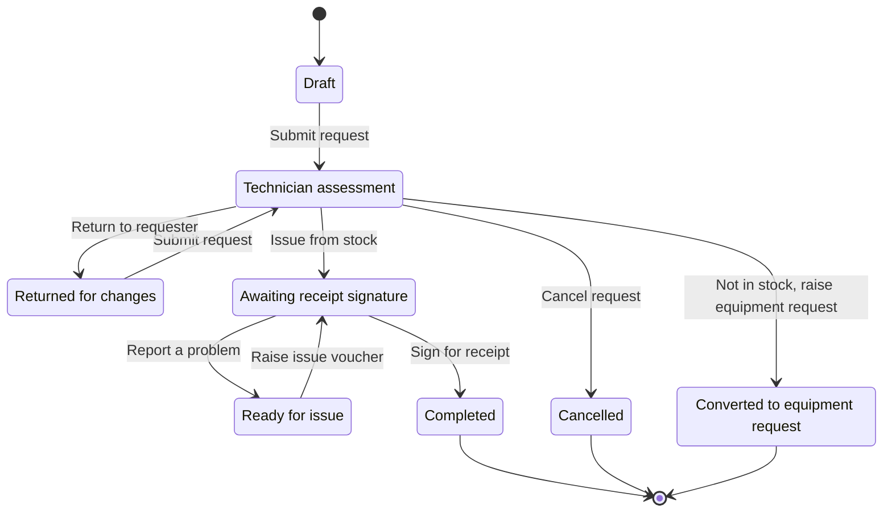
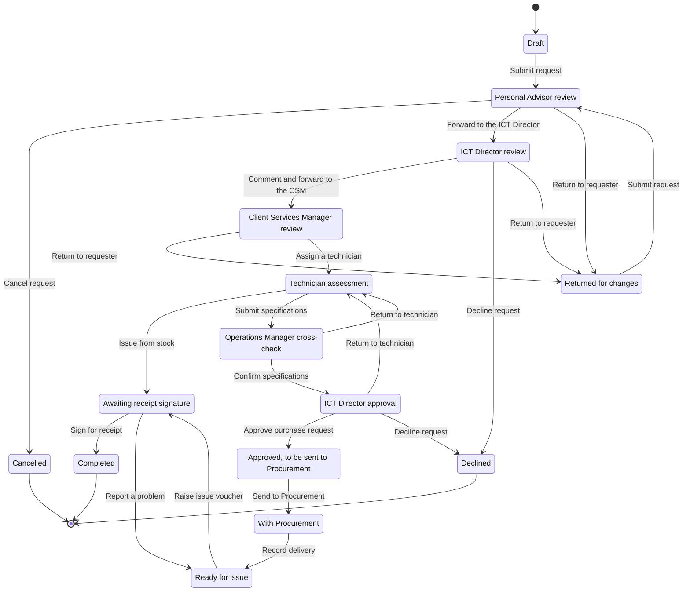
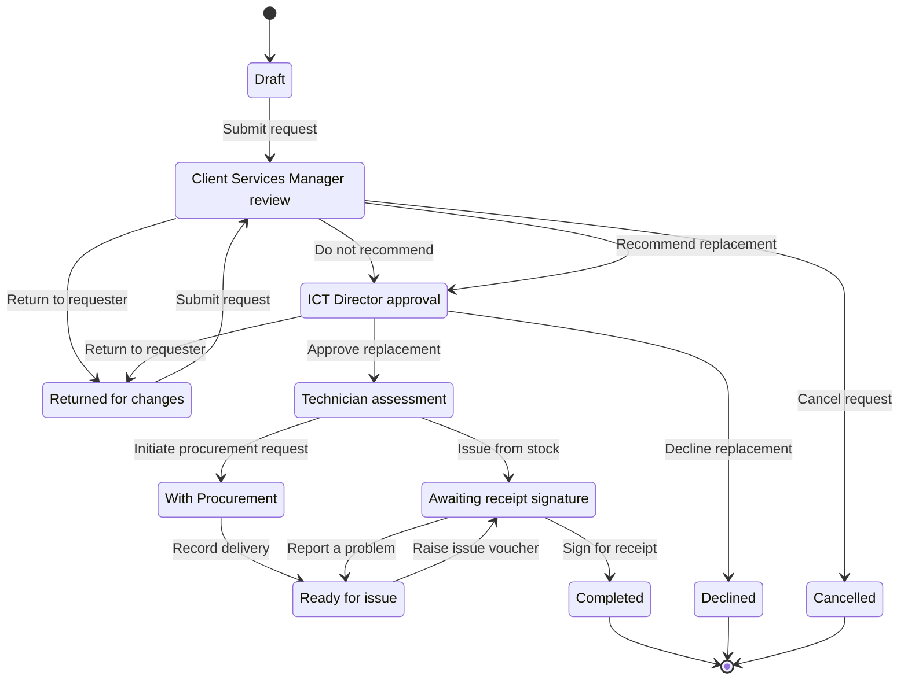

# Workflows and SOP traceability

This document maps every step in CUT ICT 38, 40 and 42 to the system. The tables come from the transition list in `apps/requisitions/workflow.py`, which is the only place the routes are defined. If a procedure changes, change that file and regenerate these tables.

## How to read the tables

- "From" is the stage the request must be in, and "To" is where it goes next.
- "Who" is the role that may act. A delegate acting for the role holder counts as that role.
- "Signed: Yes" means the officer must enter their password. The routing slip records the signature, the first-person statement they signed, and the audit hash.
- "Comment" says whether the officer must write one. Returns, declines, cancellations and disputes always need a reason.
- "SOP clause" names the step implemented. "Added control" marks a step the SOPs do not describe but the system needs; [01-design-review.md](01-design-review.md) explains each one.

## Rules that apply to every route

1. After submission, nobody can act on a request they raised. The rule covers every role and every delegate.
2. The technician assigned to a request cannot confirm their own specifications as Operations Manager, nor give the final approval, even if they hold those roles.
3. A returned request goes back, on resubmission, to the stage that returned it, so the reviewer who asked the question sees the answer.
4. Only the ICT Director declines. Other reviewers return the request with a reason.
5. The requester can cancel until the request is approved for purchase or reaches Procurement. After that only the ICT Director can cancel, with a signed reason. Delivered assets stay in stock.
6. At the technician stage of an equipment or replacement request, the technician can issue from stock instead of buying (CUT ICT 40 §5.2). The progress tracker then marks the purchasing stages as not needed.
7. Assets move into a user's name only when that user signs an issue voucher. A voucher with fewer items than the request lists needs a comment that explains the difference.
8. Each action locks the request row and checks the version the officer saw. If a colleague acted first, the officer sees a message and the latest version.

### Allocation from ICT stock (CUT ICT 40)

| Action | From | To | Who | Signed | Comment | SOP clause |
| --- | --- | --- | --- | --- | --- | --- |
| Submit request | Draft, Returned for changes | Technician assessment, or back to the stage that returned it | Requester | No | Optional | CUT ICT 40 §5.1 |
| Not in stock: raise equipment request | Technician assessment | Converted to equipment request | Help Desk Technician | No | Required | CUT ICT 38 §5.1 |
| Return to requester | Technician assessment | Returned for changes | Help Desk Technician | No | Required | Added control |
| Issue from stock | Technician assessment | Awaiting receipt signature | Help Desk Technician | No | Optional | CUT ICT 40 §5.2 |
| Raise issue voucher | Ready for issue | Awaiting receipt signature | Help Desk Technician | No | Optional | CUT ICT 40 §5.2 |
| Withdraw voucher | Awaiting receipt signature | Ready for issue | Help Desk Technician | No | Required | Added control |
| Sign for receipt | Awaiting receipt signature | Completed | Requester | Yes | Optional | CUT ICT 40 §5.3 |
| Report a problem | Awaiting receipt signature | Ready for issue | Requester | No | Required | CUT ICT 40 §5.3 |
| Take this request | Technician assessment | Same stage | Help Desk Technician | No | None | Added control |
| Reassign technician | Technician assessment, Ready for issue, Awaiting receipt signature | Same stage | Client Services Manager | No | Optional | Added control |
| Cancel request | Returned for changes, Technician assessment | Cancelled | Requester | No | Required | Added control |

### Equipment request (CUT ICT 38)

| Action | From | To | Who | Signed | Comment | SOP clause |
| --- | --- | --- | --- | --- | --- | --- |
| Submit request | Draft, Returned for changes | Personal Advisor review, or back to the stage that returned it | Requester | No | Optional | CUT ICT 38 §5.1 |
| Forward to the ICT Director | Personal Advisor review | ICT Director review | Personal Advisor | No | Optional | CUT ICT 38 §5.1 |
| Return to requester | Personal Advisor review | Returned for changes | Personal Advisor | No | Required | Added control |
| Comment and forward to the CSM | ICT Director review | Client Services Manager review | ICT Director | Yes | Required | CUT ICT 38 §5.2 |
| Return to requester | ICT Director review | Returned for changes | ICT Director | No | Required | Added control |
| Decline request | ICT Director review | Declined | ICT Director | Yes | Required | Added control |
| Assign a technician | Client Services Manager review | Technician assessment | Client Services Manager | No | Optional | CUT ICT 38 §5.3 |
| Return to requester | Client Services Manager review | Returned for changes | Client Services Manager | No | Required | Added control |
| Submit specifications | Technician assessment | Operations Manager cross-check | Help Desk Technician | No | Optional | CUT ICT 38 §5.4, §5.5 |
| Confirm specifications | Operations Manager cross-check | ICT Director approval | Operations Manager | Yes | Optional | CUT ICT 38 §5.6 |
| Return to technician | Operations Manager cross-check | Technician assessment | Operations Manager | No | Required | Added control |
| Approve purchase request | ICT Director approval | Approved, to be sent to Procurement | ICT Director | Yes | Optional | CUT ICT 38 §5.6, §5.7 |
| Return to technician | ICT Director approval | Technician assessment | ICT Director | No | Required | Added control |
| Decline request | ICT Director approval | Declined | ICT Director | Yes | Required | Added control |
| Send to Procurement | Approved, to be sent to Procurement | With Procurement | Help Desk Technician | No | Optional | CUT ICT 38 §5.8 |
| Issue from stock | Technician assessment | Awaiting receipt signature | Help Desk Technician | No | Optional | CUT ICT 40 §5.2 |
| Log a follow-up | With Procurement | Same stage | Help Desk Technician | No | Required | CUT ICT 38 §5.9 |
| Post a procurement update | With Procurement | Same stage | Procurement Officer | No | Optional | CUT ICT 42 §5.5 |
| Record delivery | With Procurement | Same stage, or Ready for issue once the delivery is complete | Help Desk Technician | No | Optional | CUT ICT 42 §5.5, §5.6 |
| Raise issue voucher | Ready for issue | Awaiting receipt signature | Help Desk Technician | No | Optional | CUT ICT 40 §5.2 |
| Withdraw voucher | Awaiting receipt signature | Ready for issue | Help Desk Technician | No | Required | Added control |
| Sign for receipt | Awaiting receipt signature | Completed | Requester | Yes | Optional | CUT ICT 40 §5.3 |
| Report a problem | Awaiting receipt signature | Ready for issue | Requester | No | Required | CUT ICT 40 §5.3 |
| Reassign technician | Technician assessment, Approved, to be sent to Procurement, With Procurement, Ready for issue, Awaiting receipt signature | Same stage | Client Services Manager | No | Optional | Added control |
| Cancel request | Returned for changes, Personal Advisor review, ICT Director review, Client Services Manager review, Technician assessment, Operations Manager cross-check, ICT Director approval | Cancelled | Requester | No | Required | Added control |
| Cancel request | Approved, to be sent to Procurement, With Procurement, Ready for issue | Cancelled | ICT Director | Yes | Required | Added control |

### Replacement request (CUT ICT 42)

| Action | From | To | Who | Signed | Comment | SOP clause |
| --- | --- | --- | --- | --- | --- | --- |
| Submit request | Draft, Returned for changes | Client Services Manager review, or back to the stage that returned it | Requester | No | Optional | CUT ICT 42 §5.1 |
| Return to requester | Client Services Manager review | Returned for changes | Client Services Manager | No | Required | Added control |
| Recommend replacement | Client Services Manager review | ICT Director approval | Client Services Manager | Yes | Optional | CUT ICT 42 §5.2 |
| Do not recommend | Client Services Manager review | ICT Director approval | Client Services Manager | Yes | Required | CUT ICT 42 §5.2 |
| Approve replacement | ICT Director approval | Technician assessment | ICT Director | Yes | Optional | CUT ICT 42 §5.3 |
| Return to requester | ICT Director approval | Returned for changes | ICT Director | No | Required | Added control |
| Decline replacement | ICT Director approval | Declined | ICT Director | Yes | Required | Added control |
| Initiate procurement request | Technician assessment | With Procurement | Help Desk Technician | No | Optional | CUT ICT 42 §5.4 |
| Issue from stock | Technician assessment | Awaiting receipt signature | Help Desk Technician | No | Optional | CUT ICT 40 §5.2 |
| Log a follow-up | With Procurement | Same stage | Help Desk Technician | No | Required | CUT ICT 38 §5.9 |
| Post a procurement update | With Procurement | Same stage | Procurement Officer | No | Optional | CUT ICT 42 §5.5 |
| Record delivery | With Procurement | Same stage, or Ready for issue once the delivery is complete | Help Desk Technician | No | Optional | CUT ICT 42 §5.5, §5.6 |
| Raise issue voucher | Ready for issue | Awaiting receipt signature | Help Desk Technician | No | Optional | CUT ICT 40 §5.2 |
| Withdraw voucher | Awaiting receipt signature | Ready for issue | Help Desk Technician | No | Required | Added control |
| Sign for receipt | Awaiting receipt signature | Completed | Requester | Yes | Optional | CUT ICT 40 §5.3 |
| Report a problem | Awaiting receipt signature | Ready for issue | Requester | No | Required | CUT ICT 40 §5.3 |
| Reassign technician | Technician assessment, With Procurement, Ready for issue, Awaiting receipt signature | Same stage | Client Services Manager | No | Optional | Added control |
| Cancel request | Returned for changes, Client Services Manager review, Technician assessment, ICT Director approval | Cancelled | Requester | No | Required | Added control |
| Cancel request | With Procurement, Ready for issue | Cancelled | ICT Director | Yes | Required | Added control |

The diagrams show the main path and the first-stage cancellation. The tables list every cancellation point.

## Stage targets

Each stage has a target in working days. Weekends and dates in the Holiday table do not count. The due date shows on the request and in the queue. A request past its target triggers one reminder a day to whoever holds it (`send_reminders`).

| Stage | Default target (working days) | Setting |
| --- | --- | --- |
| Returned for changes (requester) | 5 | `ACQ_TARGET_RETURNED` |
| Personal Advisor review | 1 | `ACQ_TARGET_PA_REVIEW` |
| ICT Director review | 2 | `ACQ_TARGET_DIRECTOR_REVIEW` |
| Client Services Manager review | 1 | `ACQ_TARGET_CSM_REVIEW` |
| Technician assessment | 3 | `ACQ_TARGET_TECHNICIAN_REVIEW` |
| Operations Manager cross-check | 2 | `ACQ_TARGET_OPS_REVIEW` |
| ICT Director approval | 2 | `ACQ_TARGET_DIRECTOR_APPROVAL` |
| Approved, to be sent to Procurement | 1 | `ACQ_TARGET_APPROVED` |
| Ready for issue | 2 | `ACQ_TARGET_READY_FOR_ISSUE` |
| Awaiting receipt signature | 3 | `ACQ_TARGET_AWAITING_ACK` |

These defaults are proposals. The SOPs ask for requests to be handled "expeditiously" (CUT ICT 38 KPI 6.1) but set no numbers, so ICT management should confirm or change them. While a request is with Procurement, the follow-up date replaces the target. The technician sets it at each follow-up; the default is 5 working days.

## Reference numbers

| Record | Format | Example | Issued |
| --- | --- | --- | --- |
| Allocation request | `ALC-year-nnnn` | `ALC-2026-0003` | On first submission |
| Equipment request | `EQR-year-nnnn` | `EQR-2026-0042` | On first submission |
| Replacement request | `RPL-year-nnnn` | `RPL-2026-0007` | On first submission |
| Issue voucher | `IV-year-nnnn` | `IV-2026-0118` | When the voucher is raised |
| Asset tag (generated) | `ICT-year-nnnnn` | `ICT-2026-00031` | When an asset is registered without a tag |

Numbers come from a locked counter per prefix and year, inside the same database transaction as the record. A failed action rolls the counter back, so numbers have no gaps. Drafts have no number.

## Retention

Each SOP ends with a "Retained Documented Information" table. The system applies it as follows.

| Record | SOP | Kept active | Then | Setting |
| --- | --- | --- | --- | --- |
| Equipment request | CUT ICT 38, 7.1 | 1 semester (183 days after closing) | Archive | `ACQ_RETENTION_EQR_DAYS` |
| Allocation request | CUT ICT 40 | 1 year after closing | Archive | `ACQ_RETENTION_ALC_DAYS` |
| Issue voucher | CUT ICT 40, 8.1 | 1 year after it was raised, whatever happens to its request | Archived tab of the voucher list | `ACQ_RETENTION_VOUCHER_DAYS` |
| Replacement request | CUT ICT 42, 8.1 | 1 year after closing | Archive | `ACQ_RETENTION_RPL_DAYS` |

`apply_retention` runs each night. Archived requests leave the working lists, become read-only, and stay visible under Archive to the Quality Auditor, the ICT Director, the CSM and system administrators. A voucher keeps its own one-year period: it stays in the voucher list for a year even when its equipment request was archived after one semester. The system never deletes a request, voucher or audit entry.
