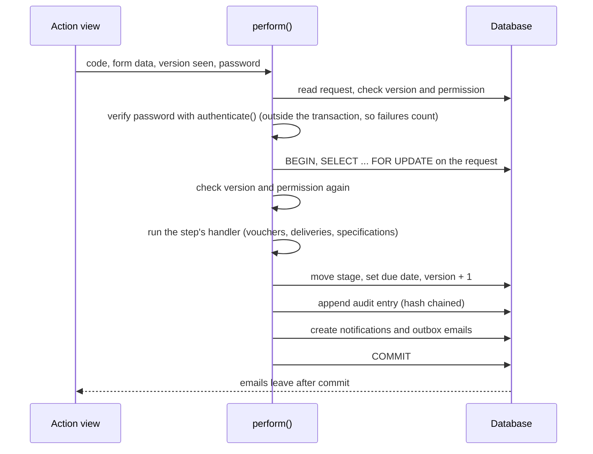
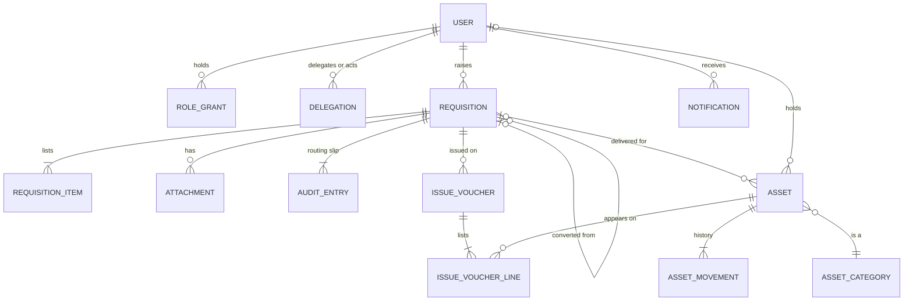

# Architecture

## Stack

| Layer | Choice | Why |
| --- | --- | --- |
| Language | Python 3.11 or later (tested on 3.13) | Readable for the ICT team; one language for the whole system |
| Framework | Django 5.2 LTS, supported until April 2028 | Mature authentication, sessions, CSRF protection, migrations and admin |
| Database | PostgreSQL 14 or later in production (tested on 16); SQLite on a developer laptop | Row locking for approvals and stock; reliable backups |
| Pages | Server-rendered Django templates, hand-written CSS, about 220 lines of plain JavaScript | Fast on the campus network, works without JavaScript, no Node build step |
| Fonts and icons | IBM Plex Sans, IBM Plex Mono and Source Serif 4 (SIL Open Font Licence); Lucide icons (ISC) | Served by the application, so pages never call the internet |
| Static files | WhiteNoise, with hashed, compressed files | No separate static server needed |
| Application server | Gunicorn behind Nginx | Standard Python deployment |
| Excel | openpyxl | Exports for CUT ICT 38 §5.7 tracking |
| Password hashing | Argon2 (argon2-cffi) | Current recommended algorithm |

## Code layout

```
config/                 Settings (environment driven), URLs, WSGI
apps/
  accounts/             User model, roles, delegations, sign-in, lockout, session rules
  core/                 Campuses, departments, holidays, numbering, notifications,
                        email outbox, dashboard, reports page, error pages, template tags
  requisitions/         Requests, items, attachments, audit trail, the workflow
                        engine (workflow.py, services.py), exports, reports data
  assets/               Asset register, movements, issue vouchers
  api/                  Read-only JSON API and API keys
templates/              Page templates, emails, error pages
static/                 CSS, JavaScript, fonts, icon sprite
deploy/                 Gunicorn, Nginx, systemd, cron, job runner
docs/                   This documentation
e2e/                    Browser test of the full route
```

## The workflow engine

Two files hold the approval logic.

`apps/requisitions/workflow.py` describes the routes as data. Each `Transition` names its code, the stages it starts from, the stage it leads to, the role that may perform it, whether it needs a comment or a signature, and the SOP clause. Queues, the process guide, notifications, reminders and the tables in [03-workflows.md](03-workflows.md) all read this list.

`apps/requisitions/services.py` holds `perform()`, the only function that changes a request's stage:



Handlers raise `WorkflowError` with a message for the user, which rolls back everything, including any asset or voucher changes and the reference number.

## Data model



| Table | Holds | Notes |
| --- | --- | --- |
| `accounts_user` | Staff accounts | Email is the sign-in name; staff number also works |
| `accounts_rolegrant` | One row per user and role | |
| `accounts_delegation` | Acting arrangements | Start, end, reason, who created and who ended it |
| `accounts_loginattempt` | Sign-in and signature attempts | Drives the lockout; kept one year |
| `requisitions_requisition` | Requests | Stage, due date, version, references, retention dates |
| `requisitions_requisitionitem` | Lines on a request | Requested item and the technician's recommended specification |
| `requisitions_attachment` | Uploaded files | SHA-256 of each file; removal is a soft delete |
| `requisitions_auditentry` | The routing slip | Append-only; hash chained |
| `assets_asset` | The asset register | Tag, serial, status, holder, location, source request |
| `assets_assetmovement` | Custody and status history | Append-only |
| `assets_issuevoucher` and `assets_issuevoucherline` | CUT ICT 40 vouchers | Lines copy the machine details at issue |
| `core_sequence` | Number counters | One row per prefix and year |
| `core_notification`, `core_outboundemail` | In-app notices and the email outbox | |
| `core_campus`, `core_department`, `core_holiday`, `assets_assetcategory` | Master data | Edited in the administration site |
| `api_apikey` | Keys for other systems | Only a SHA-256 hash is stored |

## The audit chain

Each request has its own chain of audit entries numbered from 1. An entry stores a SHA-256 hash of its own fields (who, role, on whose behalf, stages, comment, signature flag and statement, data, time) together with the previous entry's hash. Changing or deleting a row in the database breaks the chain from that point on.

- The model refuses `save()` on an existing entry and refuses `delete()`.
- The administration site shows entries read-only.
- `python manage.py verify_audit_chain` checks every request (or the references given) and exits with status 1 on any break. The cron file runs it weekly.
- The printed request record shows whether the chain is intact, with the first 12 characters of each hash.

The chain shows that a record changed. It does not stop a database administrator from rebuilding a whole chain with new hashes. To guard against that, CUT can copy the weekly verification output, or the latest hash of each request, to a separate system.

## Notifications and email

`apps/core/notify.py` writes one in-app notification and one outbox email per recipient inside the workflow transaction. After commit, a background thread sends the emails (`ACQ_EMAIL_DELIVERY=thread`). Each message is claimed with a conditional update before sending, so two senders never send it twice. Failures stay in the outbox; `deliver_emails` retries them up to six times.

Who is told:

| Event | Recipients |
| --- | --- |
| A request reaches a new stage | Everyone who can act at that stage, and the requester |
| A technician is assigned or reassigned | That technician |
| A voucher is signed or disputed | The assigned technician |
| A procurement update is posted | The assigned technician and the requester |
| A note is added | The requester, the assigned technician and whoever holds the request |
| A delegation is created | The delegate |
| A request passes its target | Whoever holds it, once a working day |

## Working days

`apps/core/workdays.py` skips Saturdays, Sundays and dates in the Holiday table. A due date keeps the time of day: a request that reaches a desk at 15:00 on Friday with a one-day target is due at 15:00 on Monday.

## Files

Uploads go to `ACQ_UPLOAD_ROOT` under random names (`requisitions/2026/10/<uuid>.pdf`). Nothing serves that folder directly. Downloads go through a view that checks the reader may see the request, and always send the file as a download. See [08-security.md](08-security.md) for the upload checks.

## Configuration

All settings come from environment variables, read in `config/settings.py`. A `.env` file in the project root is read at start-up; real environment variables win. [06-deployment.md](06-deployment.md) lists every variable.
