# User guide

This guide follows a request through the system, one role at a time. Every page has a **How approvals work** link in the menu with the same routes in short form.

## Signing in

Open the address ICT gives you and sign in with your CUT email address or staff number.

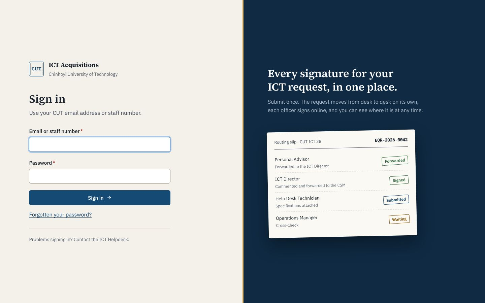

- Five wrong passwords lock the account for 15 minutes. Wait, or ask the ICT Helpdesk.
- After 30 minutes without using the system you are signed out, and the page asks you to sign in again.
- If ICT created your account with a temporary password, the system asks you to choose your own first.
- **Forgotten your password?** emails a link that works once, for two hours. If you sign in with your university directory password, reset it through the Helpdesk instead.

## Everyone: raising a request

1. Choose **New request** and pick the type. If you are unsure, choose **Allocation from ICT stock**: when ICT has nothing in stock, the Helpdesk turns it into an equipment request for you and you do not start again.

   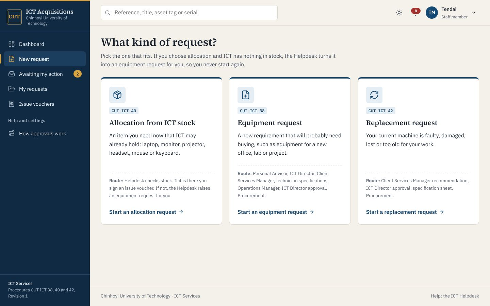

2. Give the request a short name and say why you need it. Reviewers decide from this text, so name the course, project or fault.
3. Add one line per item. **Add another item** adds a row.
4. Check the location. It starts with the location on your profile and goes on the issue voucher.
5. Attach quotations or other documents if you have them. For a lost or stolen machine, attach the police report.
6. Choose **Submit request**, or **Save as draft** to finish later. Nobody else sees a draft, and drafts take no reference number.

   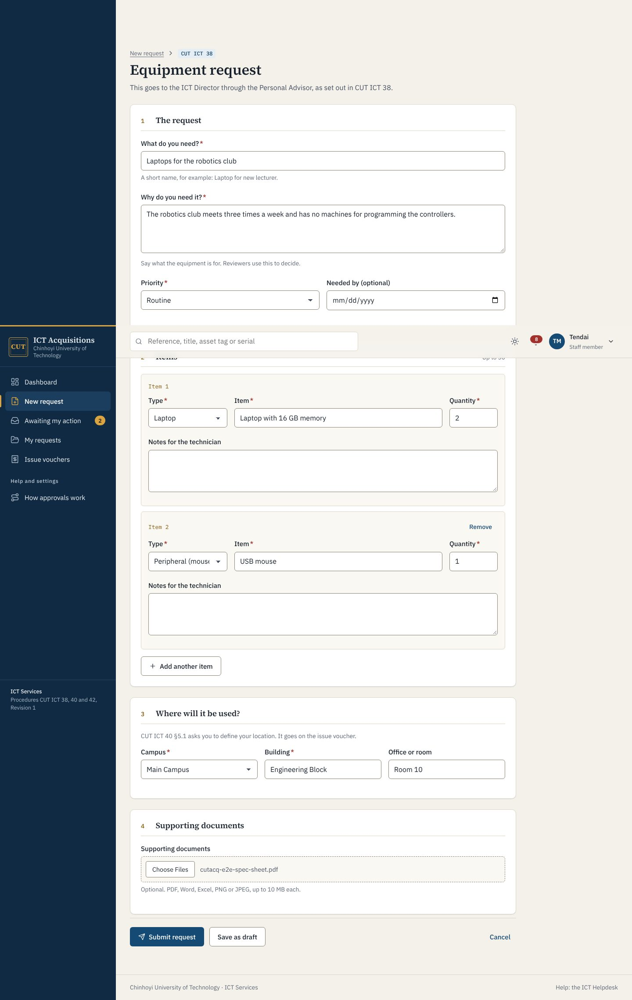

### Following your request

The request page shows the procedure header, a progress tracker, and the routing slip with every decision so far. The **With** box names the desk the request is on, since when, and when it is due.

You get an email and a notification each time the request moves.

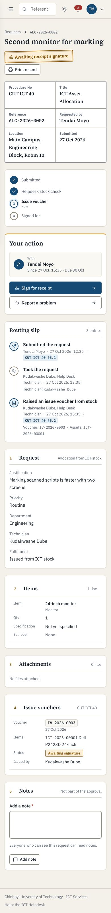

### When a request comes back to you

A reviewer may return the request with a question. The request page shows their reason at the top. Choose **Edit and resubmit**, make the change, and say what you changed in the box at the bottom. The request goes straight back to the reviewer who asked.

### Cancelling

You can cancel your own request with a reason until it is approved for purchase or reaches Procurement. After that, ask the ICT Director.

### Receiving the equipment

When the Helpdesk has your items, you get an email: "your equipment is ready. Sign the issue voucher".

1. Open the request and choose **Sign for receipt**.
2. Check each item against the voucher: asset tag, serial number, specification and condition.
3. Tick the three boxes, enter your password and sign.

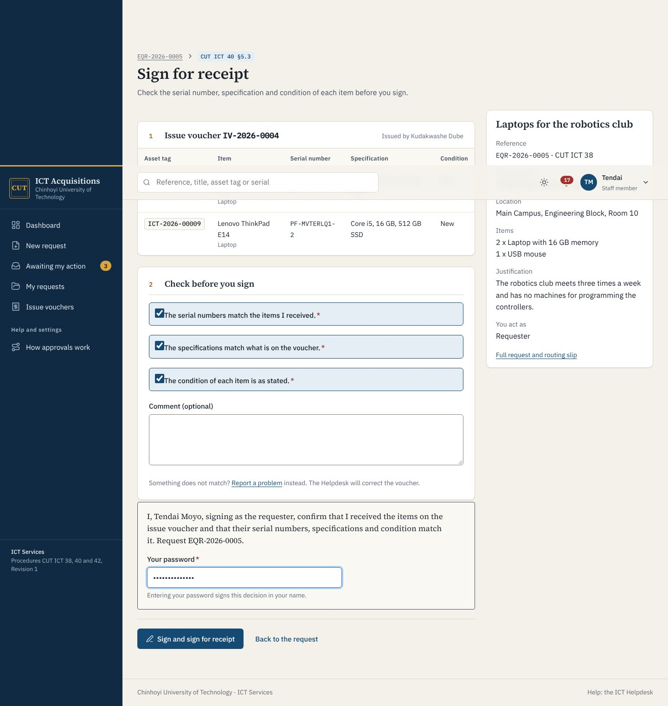

If something does not match, choose **Report a problem** instead and say what is wrong. The items go back to stock and the Helpdesk raises a corrected voucher.

The equipment then appears under **Profile and my assets**. That list is the register's record of what you hold.

## Personal Advisor

Equipment requests (CUT ICT 38) reach you first. Open each one from **Awaiting my action** and check it is complete: a clear justification, the items and the location.

- **Forward to the ICT Director** sends it on.
- **Return to requester** asks for what is missing. It comes back to you after the requester resubmits.

## ICT Director

You sign at two points of an equipment request, and decide replacements.

| Stage | Your choices |
| --- | --- |
| ICT Director review (CUT ICT 38 §5.2) | **Comment and forward to the CSM** (comment required), **Return to requester**, **Decline request** |
| ICT Director approval (CUT ICT 38 §5.6) | **Approve purchase request**, **Return to technician**, **Decline request** |
| ICT Director approval of a replacement (CUT ICT 42 §5.3) | **Approve replacement**, **Return to requester**, **Decline replacement**. The CSM's recommendation shows on the request |

Each signing step shows the statement you are signing and asks for your password.

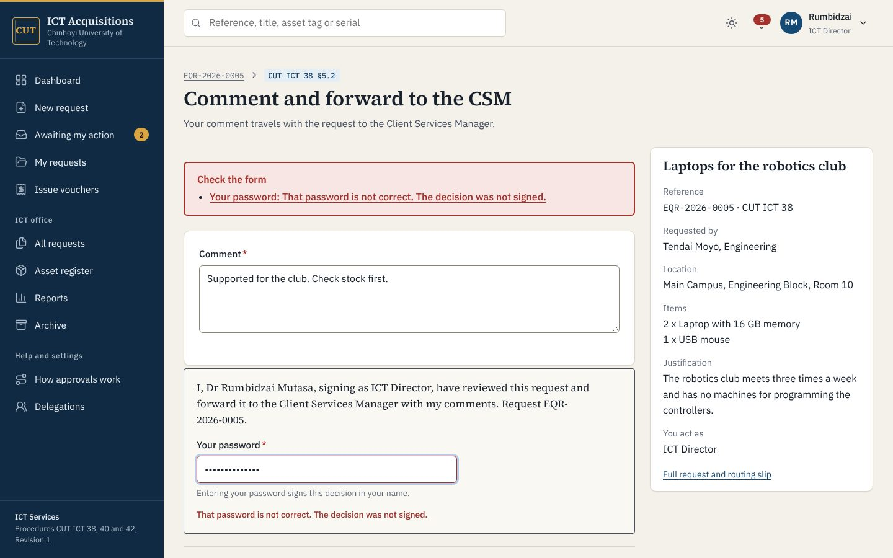

After approval you can still cancel a request with a signed reason, for example when Procurement cannot supply.

Before leave or travel, set up a delegation (**Delegations**, then **New delegation**). Your acting officer signs for you until the end date, and each decision shows both names. You cannot approve requests you raised; a delegate can.

## Client Services Manager

- **Equipment requests** (CUT ICT 38 §5.3): choose the technician who will check stock and write the specifications.
- **Replacement requests** (CUT ICT 42 §5.2): **Recommend replacement** or **Do not recommend**, with your reasons, and choose the technician. Both go to the ICT Director, who decides. Both are signed.
- At any fulfilment stage you can **Reassign technician**, for example when someone is on leave.

## Help Desk Technician

Your queue holds requests assigned to you and allocation requests that nobody has taken yet.

### Allocation requests (CUT ICT 40)

1. **Take this request**, so colleagues know you have it.
2. If the item is in stock, **Issue from stock**: tick the assets, confirm the location, and raise the voucher. The table shows assets of the requested types; **Show all stock** lists everything.
3. If it is not in stock, **Not in stock: raise equipment request**. The system opens an equipment request for the same person and items, and sends it to the Personal Advisor.

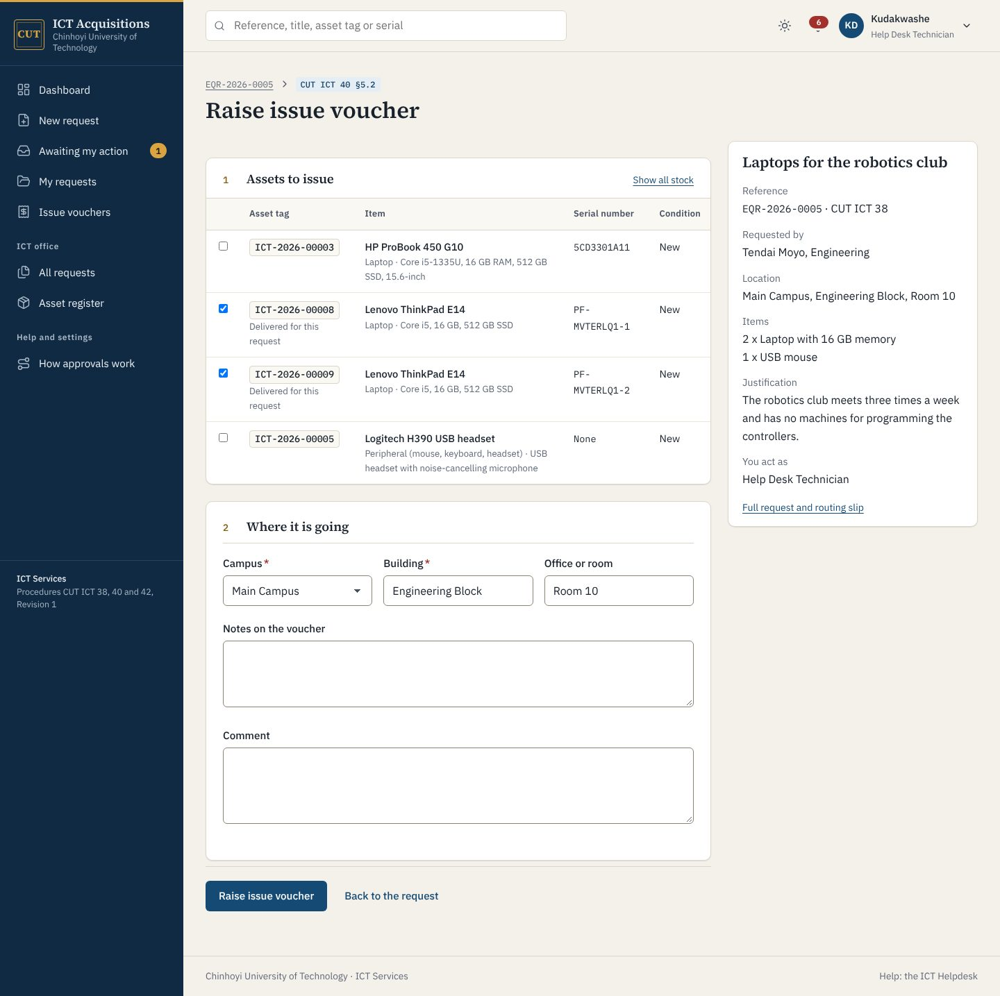

### Equipment requests (CUT ICT 38 §5.4 to §5.9)

1. Check stock first. If an item is there, **Issue from stock** ends the route without a purchase.
2. Otherwise **Submit specifications**: write the recommended specification for each item, add an estimated unit cost if you have one, and attach at least one specification sheet.
3. After the Operations Manager and the ICT Director sign, **Send to Procurement** with the requisition number Procurement gives you.
4. **Log a follow-up** each time you chase Procurement. Say who you spoke to and set the next date. The system reminds you on that date.
5. When goods arrive, **Record delivery**: one row per physical item, with serial number and specification. Each row becomes an asset in stock linked to the request. Tick **The order is complete** when nothing more is expected.

   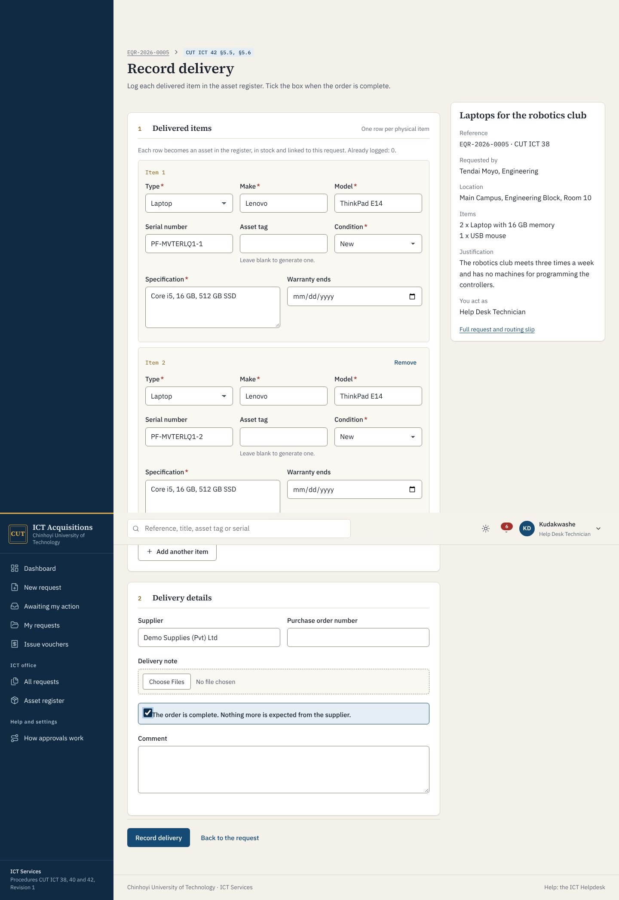

6. **Raise issue voucher**. The delivered assets are ticked already. If you issue fewer items than were requested, the comment must say why.

If you made a mistake on a voucher before the user signs, **Withdraw voucher** puts the assets back in stock.

### Replacement requests (CUT ICT 42 §5.4 to §5.6)

After the ICT Director approves, **Initiate procurement request** with the specification sheet and the Procurement number, or issue from stock. When you raise the voucher, record whether you collected the old machine and its condition. A collected machine moves to "Returned, awaiting assessment"; one left with the user stays on their record.

### The asset register

**Asset register** lists every asset with its status, holder and location. **Register asset** adds stock ICT already holds. On an asset's page you can record returns, repairs, losses and found items. Only the CSM or the ICT Director can record a disposal. Issuing to a person always goes through a voucher.

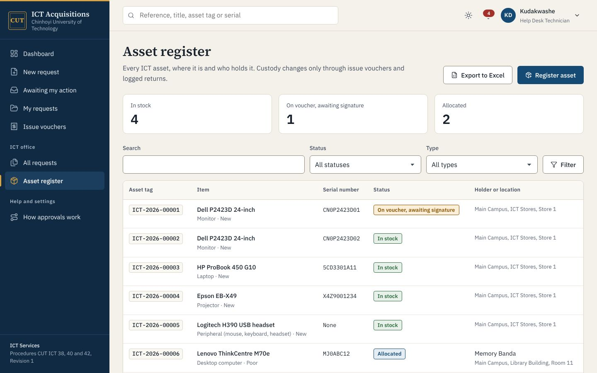

## Operations Manager

At **Operations Manager cross-check** (CUT ICT 38 §5.6), compare the technician's specifications and attachments with the requirement. **Confirm specifications** and sign, or **Return to technician** with what needs changing.

## Procurement Officer

If Procurement uses the system, requests sent to Procurement appear in your queue. **Post a procurement update** records the status, purchase order number and expected delivery date. The technician and the requester are told.

## Quality Auditor

You can read every request, voucher, asset and report, including the archive, but cannot act. For each request, **Print record** produces the retained record: the procedure header, items, every signature with its hash, and whether the audit chain is intact.

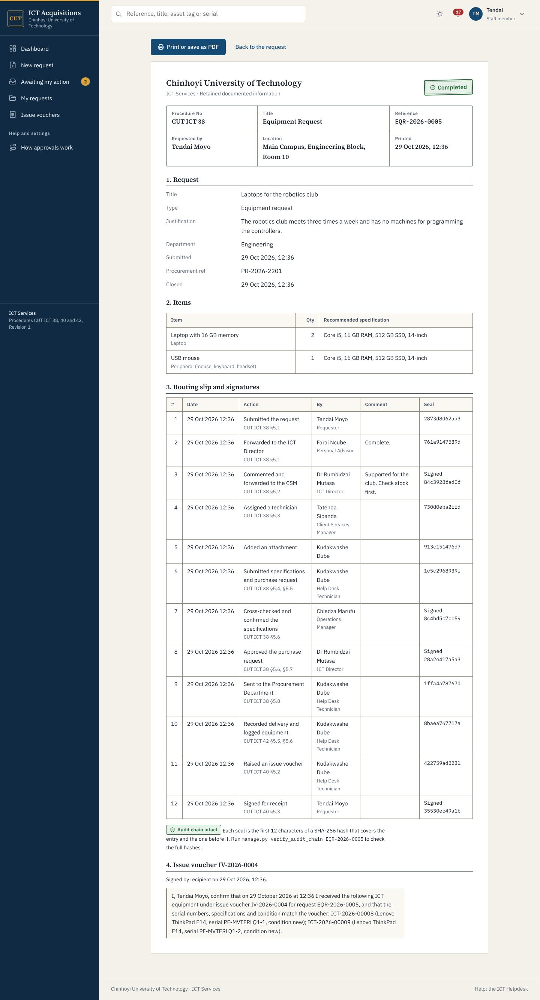

## Reports

The Director, the CSM, the Operations Manager, auditors and administrators see **Reports**: requests at each desk now, time spent at each stage against its target, submission-to-signature times, voucher figures (CUT ICT 40 KPI) and asset movements (CUT ICT 42 KPI). Both registers export to Excel.

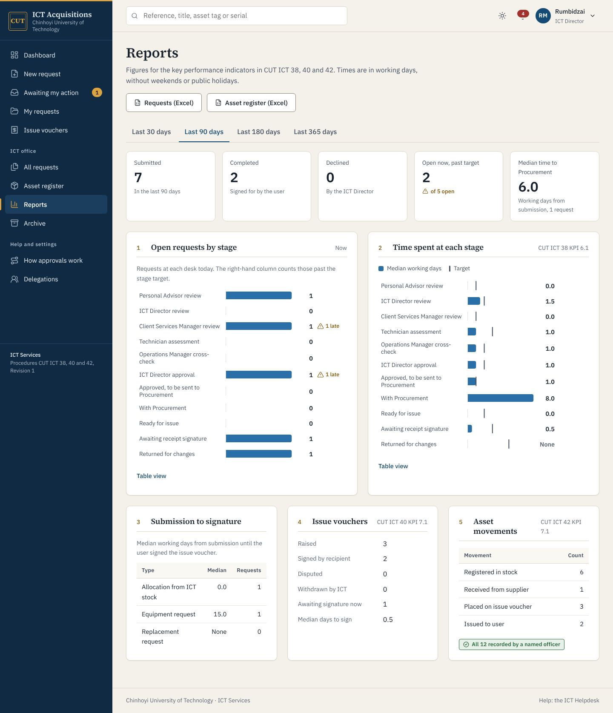

## Notes

Anyone who can see a submitted request can add a note. Notes do not change the request's stage. Everyone involved gets them by email.

## Dark mode

The sun and moon button at the top switches between light and dark. The system follows your device setting until you choose.

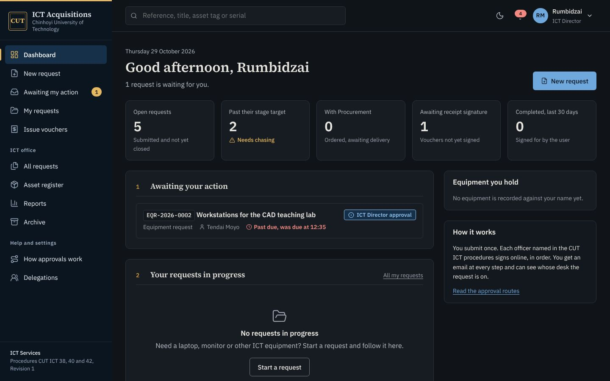
